# Tourly: a travel-booking site built to practise security from scratch

Tourly (first named *Trouly*: **T**rusted **R**eservation **O**f **U**nique **L**ocal activit**Y**) is a
full-stack booking website. Visitors browse trips, users book them, managers publish trips and admins
run the platform.

The real purpose of the project is **learning how to build security into a web application by hand**.
Version 2 is the result of a full security review of v1: 19 findings were fixed, each one is covered by an
automated test, and most controls (rate limiting, CSRF tokens, the session store, file-type detection,
security headers and validation) are **written from scratch** so you can read exactly how they work.

<p align="center">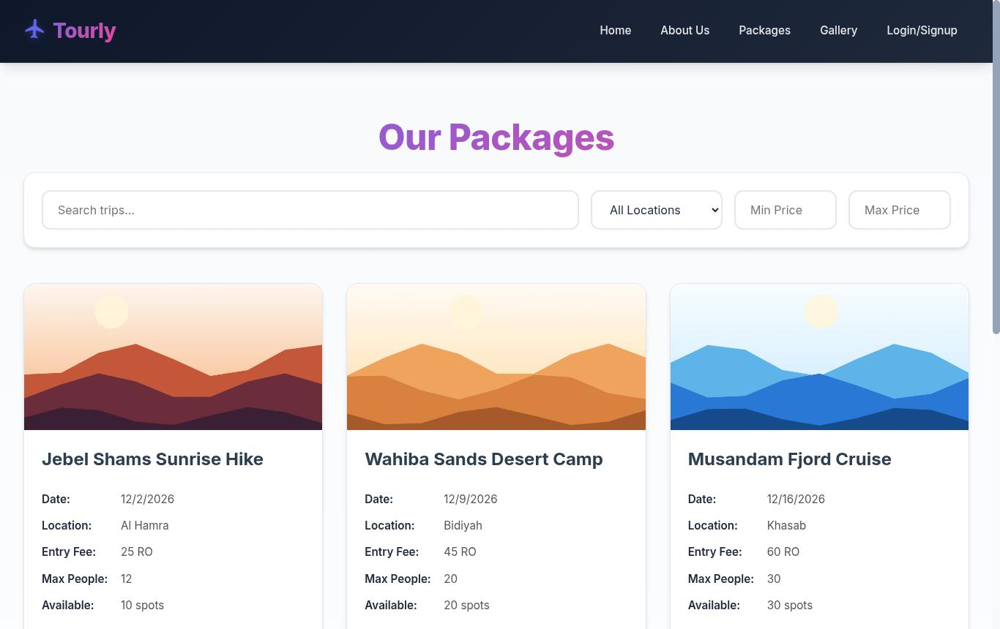</p>

| | |
|---|---|
| **Stack** | Node.js · Express 5 · SQLite (built-in `node:sqlite`) · React 19 · Vite |
| **Security review** | [`docs/Security-Review-v1.docx`](docs/Security-Review-v1.docx): findings, evidence, diagrams |
| **Security design** | [`docs/SECURITY.md`](docs/SECURITY.md): threat model, every control and where it lives |
| **Tests** | 31 backend tests (`npm test`) + a full browser walkthrough of every role |

---

## Security features (v2)

| Area | What Tourly does |
|---|---|
| 🔑 **Passwords** | bcrypt (cost 12) · NIST-style policy: 8–64 characters, common passwords rejected, no forced symbols |
| 🚫 **Brute force** | Rate limiter written from scratch · account locks for 15 min after 5 wrong passwords · same answer and timing for unknown emails |
| 🍪 **Sessions** | New session ID at login (no fixation) · `HttpOnly` + `SameSite=Strict` cookie · 30-min idle **and** 8-h absolute timeout · stored in SQLite, not memory |
| 🔁 **Session revocation** | Changing your password signs you out on every other device · email/password changes need the current password |
| 🛡️ **CSRF & CORS** | Synchronizer CSRF token on every POST/PUT/DELETE · CORS allow-list from `.env` |
| 🧱 **Headers** | CSP, `nosniff`, `X-Frame-Options`, Referrer-Policy, COOP/CORP, Permissions-Policy, HSTS in production |
| ✅ **Validation** | Hand-written validators with field-level errors · database `CHECK` constraints as a second layer · every SQL value is a bound parameter |
| 👮 **Authorization** | Role read from the database on every request · ownership checks against IDOR · one `canManageTrip()` policy (admins can manage everything) |
| 🎟️ **Booking integrity** | Seat check and seat update are **one atomic SQL statement**: tested with 10 simultaneous bookings for 3 seats |
| 🖼️ **Image uploads** | Real type checked from the file's bytes · image **re-encoded** (strips hidden payloads and GPS/EXIF data) · server-chosen random name · private folder · served with `nosniff` + CSP sandbox |
| 🙈 **No data leaks** | Responses built from explicit field lists · generic error messages with a request ID · no server paths in the API |
| 📜 **Audit log** | Logins, failed logins, lockouts, role changes, trip and booking changes, visible to admins |
| 🧪 **Demo mode** | Demo accounts for learners, refused when `NODE_ENV=production`; `npm run create-admin` for real installs |

What changed from v1, and why, is explained finding by finding in the [security review](docs/Security-Review-v1.docx).

---

## Quick start

**Requirements:** [Node.js](https://nodejs.org) **22.13 or newer** (the database uses Node's built-in SQLite driver).

### 1. Backend

```bash
cd backend
npm install
cp .env.example .env        # Windows: copy .env.example .env
```

Open `backend/.env` and set `SESSION_SECRET` to a long random value. Generate one with:

```bash
node -e "console.log(require('crypto').randomBytes(48).toString('hex'))"
```

Then create the demo data and start the API:

```bash
npm run seed     # demo accounts + sample trips (only when DEMO_MODE=true)
npm start        # http://localhost:5000
```

### 2. Frontend (in a second terminal)

```bash
cd frontend
npm install
npm run dev      # http://localhost:5173
```

Open **http://localhost:5173**. The Vite dev server forwards `/api` to the backend, so the browser
only ever talks to one origin.

### Demo accounts

Created by `npm run seed` when `DEMO_MODE=true`. **For local learning only.**

| Role | Email | Password |
|---|---|---|
| Admin | `admin@tourly.demo` | `Demo-Admin-2026!` |
| Manager | `manager@tourly.demo` | `Demo-Manager-2026!` |
| User | `user@tourly.demo` | `Demo-User-2026!` |

For a real installation set `DEMO_MODE=false` and create your own admin:

```bash
npm run create-admin   # asks for email, name and password (typed hidden, policy-checked)
```

---

## Screenshots

### Security in action

| | |
|---|---|
| **Common passwords are rejected** <br>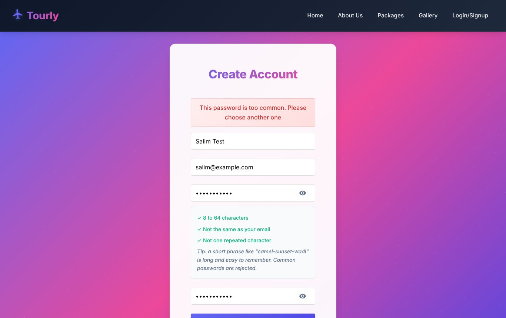 | **Account lockout after 5 failed logins** <br>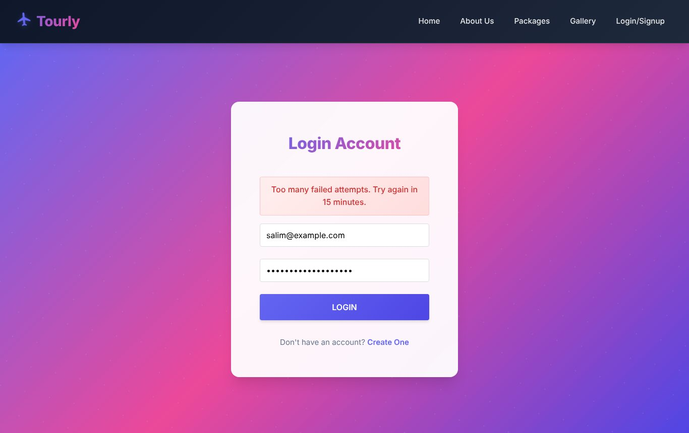 |
| **A disguised file is rejected (browser *and* server)** <br>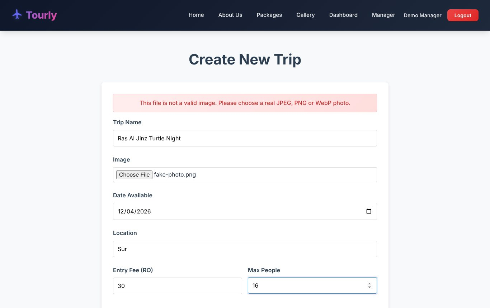 | **Changing the email asks for the current password** <br>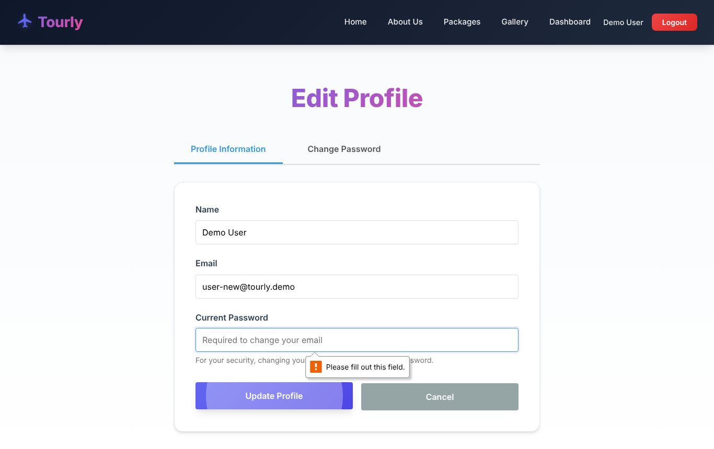 |
| **Admin security log** <br>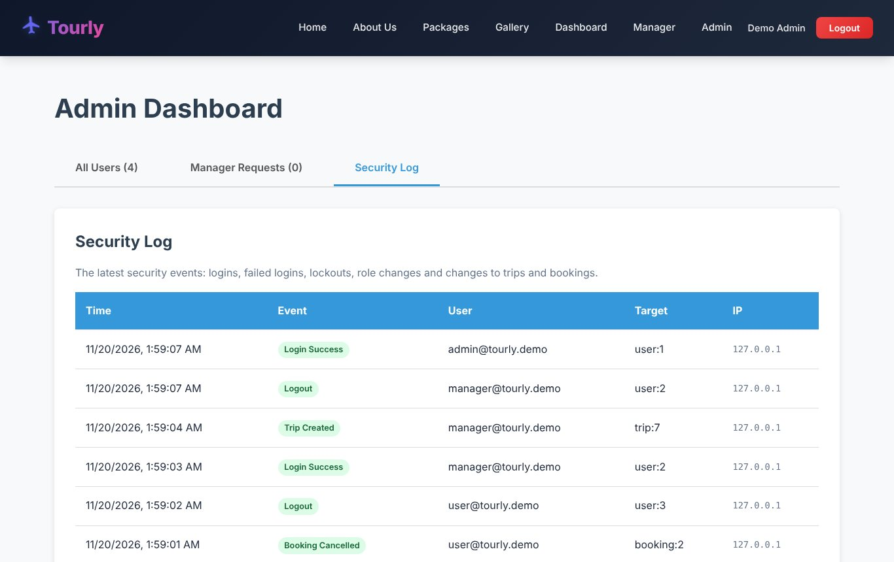 | **31 automated security tests** <br>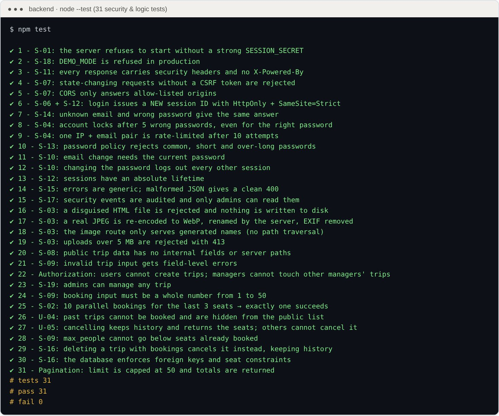 |

### The application

| | |
|---|---|
| **User dashboard with booking status** <br>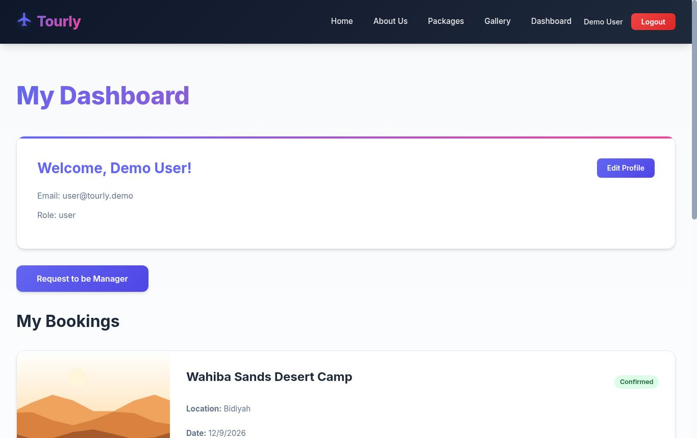 | **Booking confirmation** <br>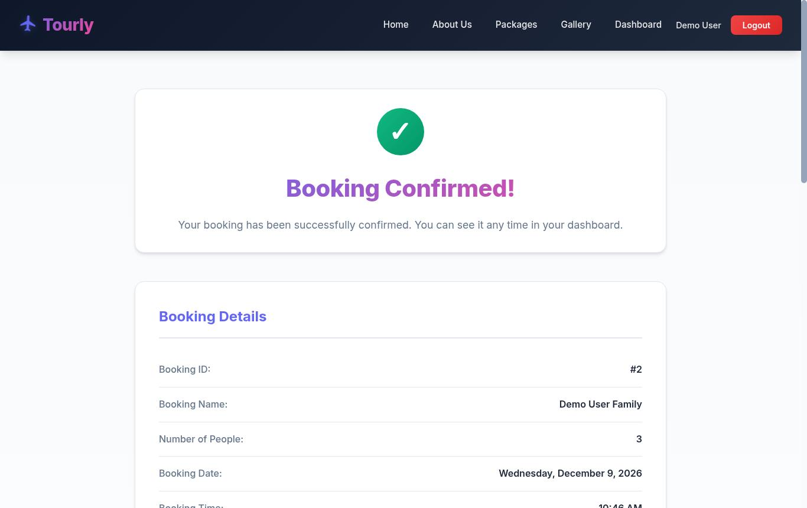 |
| **Cancelled bookings stay in history** <br>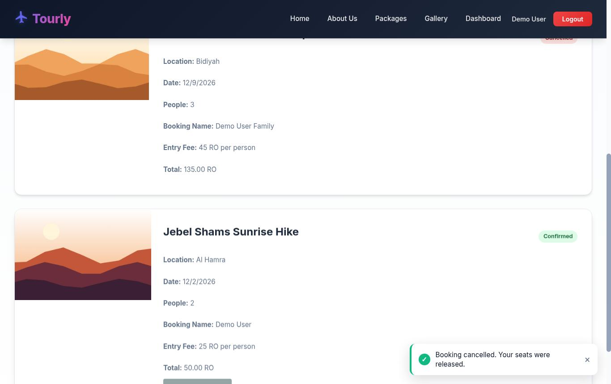 | **Manager dashboard** <br>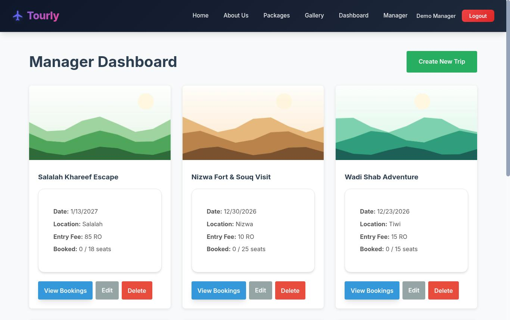 |
| **Bookings for a trip** <br>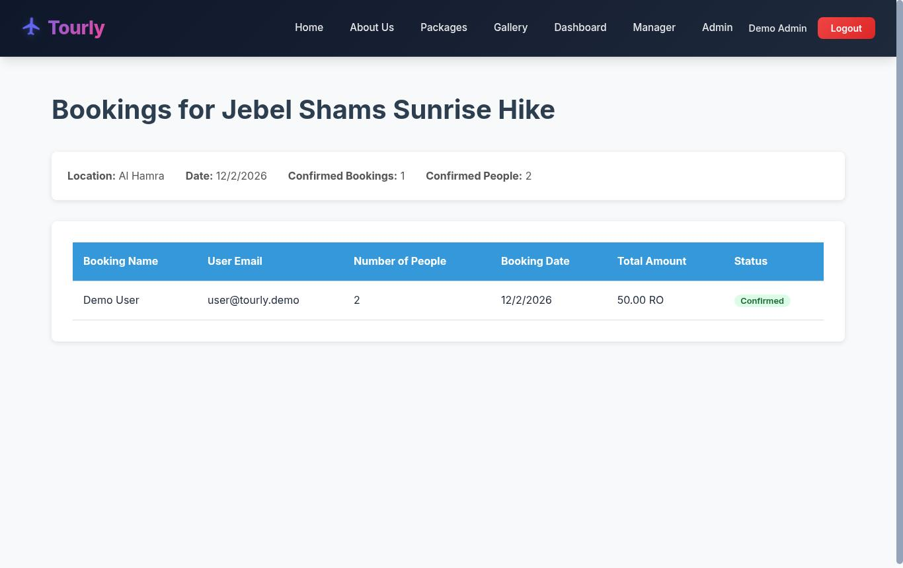 | **Trips with bookings are cancelled, not deleted** <br>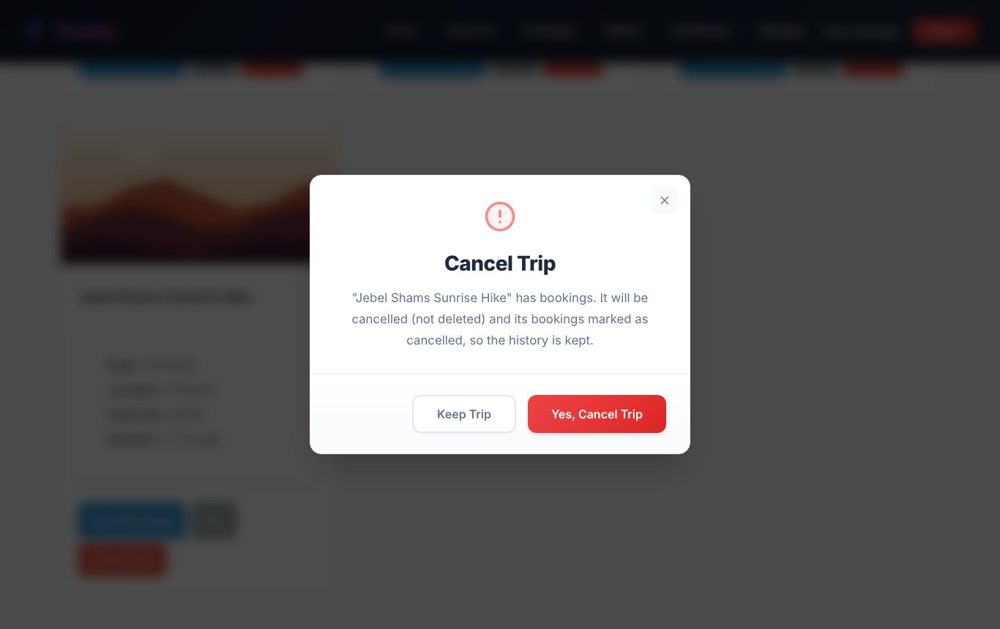 |
| **Admin: users and roles** <br>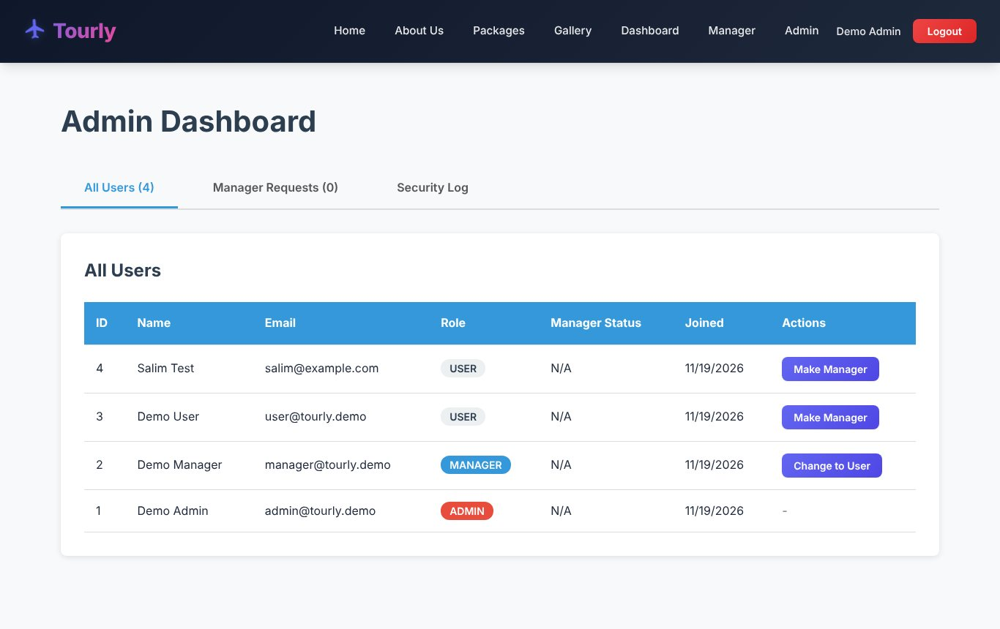 | **Home** <br> |

---

## Features

**Visitors:** browse upcoming trips, search and filter by location and price, "show more" pagination.

**Users:** sign up and log in · book trips (seat limits enforced) · booking history with *Confirmed / Completed / Cancelled* status · cancel upcoming bookings · edit profile · request manager access · inactivity warning before automatic logout.

**Managers:** create and edit trips with an image · see who booked each trip · delete a trip without bookings, or cancel a trip with bookings (history is kept).

**Admins:** everything a manager can do, for **all** trips · approve or reject manager requests · change roles · read the security log.

---

## Project structure

```
backend/
├── src/
│   ├── app.js                 # builds the Express app: the security pipeline in order
│   ├── server.js              # starts the server
│   ├── config/env.js          # loads and validates .env (fail fast)
│   ├── db/                    # schema.sql · connection.js · seed.js · createAdmin.js
│   ├── security/              # written from scratch: rateLimit · csrf · sessionStore · headers
│   │                          #   password · imageType · audit
│   ├── middleware/            # auth (roles, sessions) · upload limits · error handler
│   ├── validators/            # hand-written input validation
│   ├── services/              # imageService: the upload pipeline
│   ├── views/                 # response allow-lists (what each API response may contain)
│   ├── controllers/           # auth · users · trips · bookings · admin
│   └── routes/index.js        # every route and its protections in one file
├── tests/                     # node:test security and logic tests
├── data/common-passwords.txt  # password deny-list
├── storage/trips/             # uploaded images (private, git-ignored)
└── .env.example
frontend/
└── src/                       # React app: pages · components · context · services/api.js
docs/
├── SECURITY.md                # threat model and controls
├── Security-Review-v1.docx    # the review behind v2
└── screenshots/
```

---

## API

All routes are under `/api`. Every `POST`, `PUT` and `DELETE` needs the `X-CSRF-Token` header
(get it from `GET /api/auth/csrf`).

| Method & path | Access | Notes |
|---|---|---|
| `GET /auth/csrf` | public | returns `{ csrfToken }` |
| `POST /auth/register` | public | rate-limited · password policy |
| `POST /auth/login` | public | rate-limited · account lockout |
| `POST /auth/logout` | any | |
| `GET /auth/me` | any | `{ user }` or `{ user: null }` |
| `GET /users/profile` · `PUT /users/profile` | user | email/password changes need `currentPassword` |
| `GET /users/bookings` | user | booking history with status |
| `POST /users/request-manager` · `POST /users/cancel-manager-request` | user | |
| `GET /trips` | public | `?search&location&minPrice&maxPrice&date&page&limit` (max 50) |
| `GET /trips/:id` | public | |
| `GET /trips/my-trips` | manager, admin | admins see all trips |
| `POST /trips` · `PUT /trips/:id` | manager (own), admin | multipart with `image` · upload rate limit |
| `DELETE /trips/:id` | manager (own), admin | deletes, or cancels when bookings exist |
| `POST /bookings` | user | atomic seat reservation |
| `GET /bookings/my-bookings` | user | |
| `DELETE /bookings/:id` | owner | marks the booking cancelled and releases seats |
| `GET /bookings/trip/:tripId` | manager (own), admin | |
| `GET /admin/users` · `GET /admin/manager-requests` | admin | |
| `POST /admin/manager-requests/:id/approve` · `/reject` | admin | |
| `PUT /admin/users/:id/role` | admin | cannot change own role or demote an admin |
| `GET /admin/audit-log` | admin | `?limit` (max 200) |
| `GET /images/:name` | public | only server-generated names · `nosniff` + CSP sandbox |

---

## Testing

```bash
cd backend
npm test
```

The tests start a fresh app with a temporary database and attack it the way a real client would:
missing CSRF tokens, brute-force logins, a session ID planted before login, an HTML file disguised as a
PNG, path traversal on the image route, 10 simultaneous bookings for the last 3 seats, users trying to
cancel other people's bookings, and more. GitHub Actions runs them on every push, along with a frontend
build and `npm audit`.

---

## Limitations

This is a learning project, not a production service. Known limits (in-memory rate-limit counters,
HTTPS left to the hosting setup, SQLite's single writer, and others) are listed with their mitigations in
[`docs/SECURITY.md`](docs/SECURITY.md#5-known-limitations).

## License

[ISC](LICENSE)
